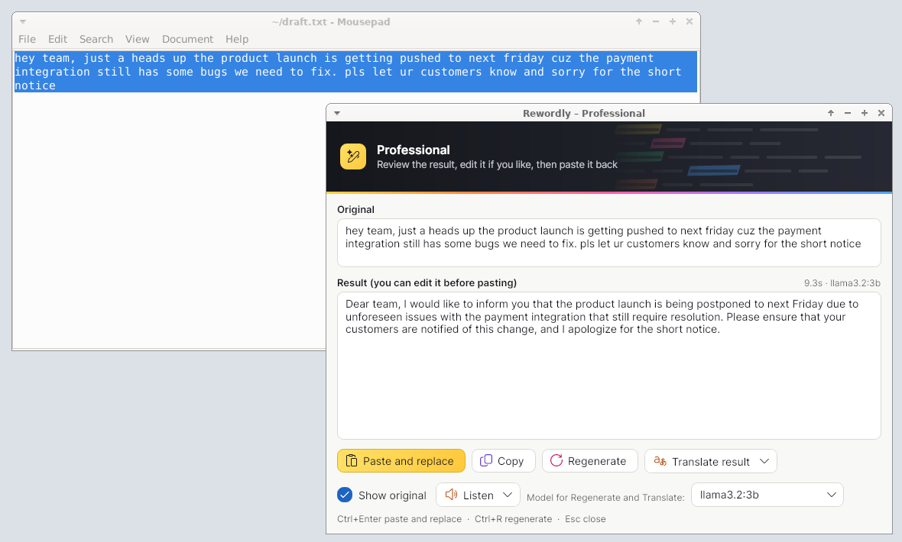
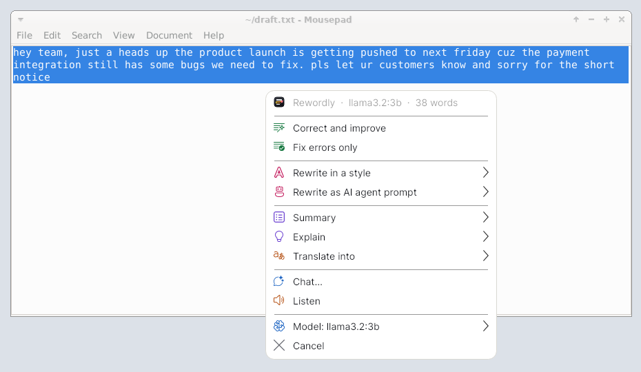
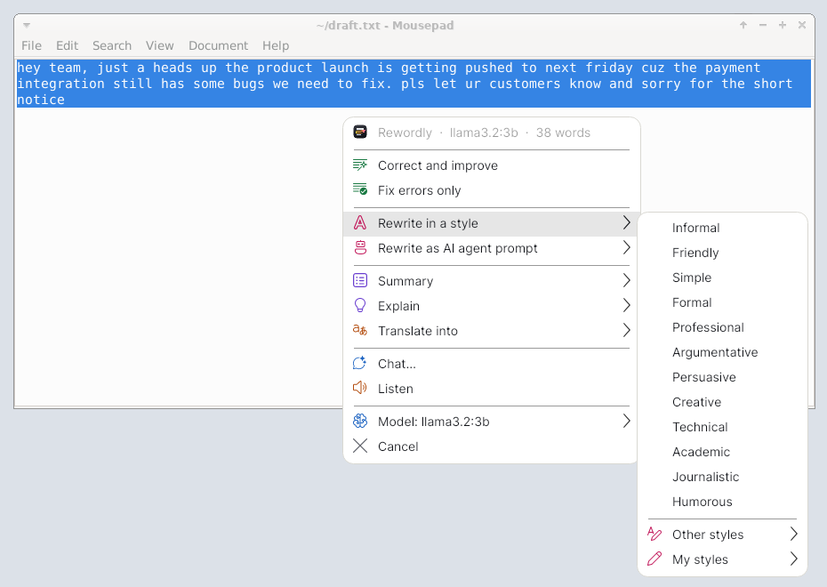
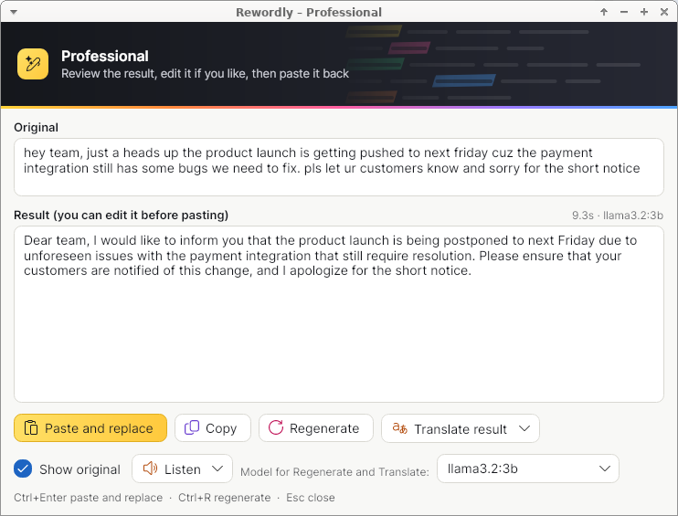
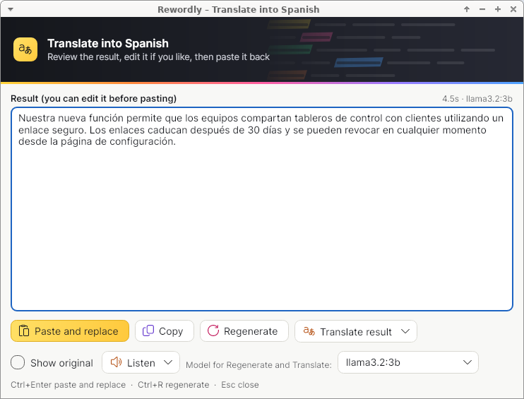
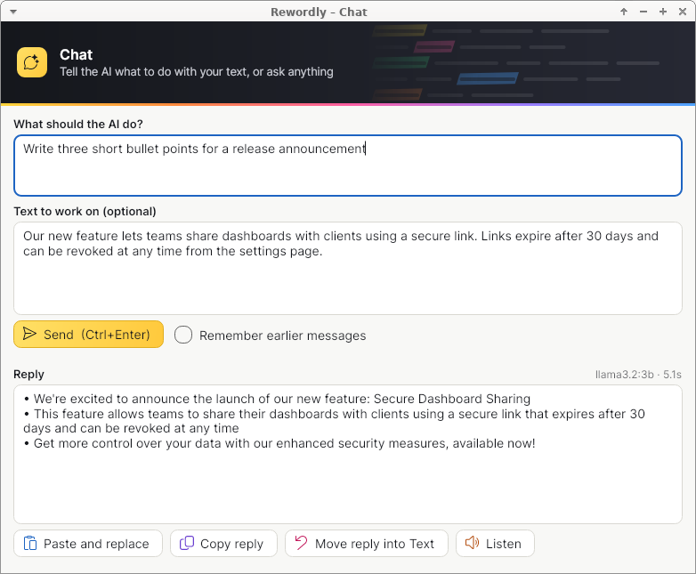
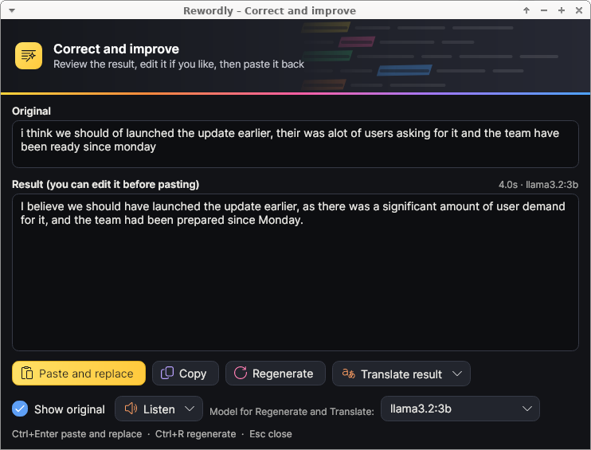
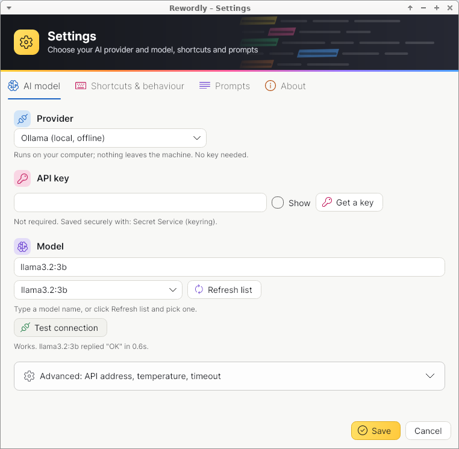
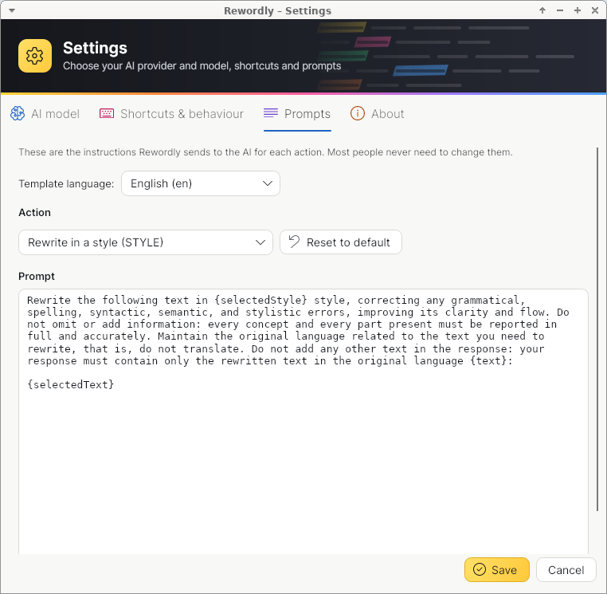

# Rewordly

[](https://github.com/GeekLord/Rewordly/releases/latest)
[](https://github.com/GeekLord/Rewordly/releases)
[](https://github.com/GeekLord/Rewordly/actions/workflows/ci.yml)
[](https://github.com/GeekLord/Rewordly/actions/workflows/release.yml)
[](LICENSE)
[](https://dotnet.microsoft.com/)
[](https://avaloniaui.net/)
[](#downloads)
[](https://shobhit.net)

**Rewrite, proofread, summarise, explain, translate, chat about or read aloud any selected text, in any app.** Select text, press `Ctrl+C` twice (`Cmd+C` on macOS), and a Rewordly menu opens at your pointer. Pick an action, review the result, and paste it back in place.

Rewordly is an independent, cross-platform desktop application for Windows, macOS and Linux. It is written in C# with .NET 8, [Avalonia UI](https://avaloniaui.net/) for the interface and [SharpHook](https://github.com/TolikPylypchuk/SharpHook) for system-wide keyboard handling. Each download is a single self-contained executable: no .NET runtime or other dependency is needed on the user's machine.

Developed by **[Shobhit Kumar Prabhakar](https://shobhit.net)**.



**[Documentation](docs/README.md)** · [Getting started](docs/getting-started.md) · [Using Rewordly](docs/using-rewordly.md) · [AI providers](docs/ai-providers.md) · [Settings](docs/settings.md) · [Troubleshooting](docs/troubleshooting.md)

## Features

### Text actions

- **Context menu at the pointer:** press the copy shortcut twice in any app, or use the alternative shortcut that leaves the clipboard unchanged.
- **Rewrite in a style:** 12 main styles (Formal, Informal, Technical, Academic and more), 5 extra styles (Narrative, Descriptive, Expository, Poetic, Satirical) and your own custom styles. Recently used styles appear first.
- **Proofreading:** **Correct and improve** for clarity and flow, or **Fix errors only** to keep your wording.
- **Summary:** short, medium or long summaries (about 30%, 50% or 70% of the original length).
- **Explain:** explanations for four knowledge levels: None, Basic, Intermediate and Advanced.
- **Translate:** 27 built-in languages plus any language you add, with recently used languages first.
- **Rewrite as AI agent prompt:** turn a rough request into a structured prompt for a general agent, a coding agent, a research agent, a system prompt or a chat assistant, plus an **Image AI** section for image generation and image editing prompts. Templates live in [`prompts/`](prompts/README.md).
- **Chat:** give your own instruction about the selected text, with prompt history, copy and paste-back.
- **Listen:** read text aloud with your operating system's voices, with speed control and language detection.

### Result window

- Compare the result with the original text, edit it, copy it, or **Paste and replace** it into the app you came from (`Ctrl+Enter` / `Cmd+Enter`).
- **Regenerate** (`Ctrl+R` / `Cmd+R`), translate the result into another language and **Undo translation**, or listen to it.

### AI providers

- Presets for **Google Gemini, OpenAI, OpenRouter, Groq** and local **Ollama**, plus any **OpenAI-compatible server**.
- Model list loaded from the provider, recent models in the tray menu, **Test connection**, and advanced settings for API address, temperature and timeout.
- API keys can also come from environment variables (see [AI Provider Configuration](#ai-provider-configuration)).

### Personalisation

- **Prompt editor:** every prompt is editable under **Settings › Prompts**, with **Reset to default**. Built-in prompts are available in English, Italian, Spanish, French, German and Hindi.
- System, light and dark themes; start at login; pause shortcuts from the tray icon; adjustable double-copy interval and selection word limit; optional clipboard restore after each action.
- A **Quick guide** with the steps for your operating system.

### Privacy and security

- **No Rewordly cloud:** your text goes straight from your computer to the AI provider you choose, and nowhere else.
- **Encrypted key storage:** Windows DPAPI, macOS Keychain, or Linux Secret Service (with an encrypted local file as fallback).
- **Verifiable downloads:** each release includes `SHA256SUMS.txt`; macOS app bundles are ad-hoc signed.

### For developers

- Automated GitHub Releases for six targets (Windows, macOS and Linux on x64 and ARM64) from a single **Run workflow** button. See [Releasing](#releasing).
- The `Rewordly.Core` library (prompts, settings and AI provider clients) is published as a NuGet package on [GitHub Packages](#using-the-rewordlycore-package).

## Screenshots

| | |
| --- | --- |
|  |  |
| Select text, press `Ctrl+C` twice: the menu opens at your pointer. | 12 main styles, 5 extra styles and your own. |
|  |  |
| Compare, edit, regenerate, then paste back in place. | Translate into 27 languages or any language you type. |
|  |  |
| Chat about the selected text with your own instruction. | System, light and dark themes. |
|  |  |
| Gemini, OpenAI, OpenRouter, Groq, Ollama or any OpenAI-compatible server. | Every prompt is editable, in 6 languages. |

More screenshots and step-by-step guides are in the [documentation](docs/README.md).

## Downloads

Download the archive for your system from the [latest release](https://github.com/GeekLord/Rewordly/releases/latest). Each release also includes `SHA256SUMS.txt` for verifying the downloads.

| Operating System | Architecture | Distribution Package | Execution Binary |
| --- | --- | --- | --- |
| Windows 10/11 | x64 (Intel / AMD) | `Rewordly-2.1.1-win-x64.zip` | `Rewordly.exe` (Self-contained) |
| Windows 11 | ARM64 | `Rewordly-2.1.1-win-arm64.zip` | `Rewordly.exe` (Self-contained) |
| macOS 11+ | ARM64 (Apple Silicon M1–M4) | `Rewordly-2.1.1-osx-arm64.zip` | `Rewordly.app` (Ad-hoc signed) |
| macOS 11+ | x64 (Intel) | `Rewordly-2.1.1-osx-x64.zip` | `Rewordly.app` (Ad-hoc signed) |
| Linux (X11) | x64 | `Rewordly-2.1.1-linux-x64.tar.gz` | `Rewordly` (Single executable) |
| Linux (X11) | ARM64 | `Rewordly-2.1.1-linux-arm64.tar.gz` | `Rewordly` (Single executable) |

## Keyboard Shortcuts

| Action | Windows | macOS | Linux (X11) |
| --- | --- | --- | --- |
| Primary trigger | `Ctrl+C` twice (hold `Ctrl`) | `Cmd+C` twice (hold `Cmd`) | `Ctrl+C` twice (hold `Ctrl`) |
| Alternative trigger (keeps clipboard unchanged) | `Ctrl+Insert` | `Ctrl+Cmd+C` | `Ctrl+Alt+C` (requires `xclip` or `xsel`) |
| Paste and replace result | `Ctrl+Enter` | `Cmd+Enter` | `Ctrl+Enter` |
| Regenerate result | `Ctrl+R` | `Cmd+R` | `Ctrl+R` |

> [!NOTE]
> You can configure the trigger interval in Settings. The default interval is 800 milliseconds.

## Installation Procedures

### Windows Installation

#### Purpose
Install and execute Rewordly on Windows 10 or Windows 11.

#### Prerequisites
- Windows 10 64-bit (build 19041 or higher) or Windows 11.

#### Procedure
1. Extract `Rewordly-2.1.1-win-x64.zip` (or the ARM64 archive) to an installation directory.
2. Execute `Rewordly.exe`.
3. If Windows SmartScreen displays a warning, select **More info**, then select **Run anyway**.
4. Configure your preferred AI provider in the Settings window.

#### Verification
Execute `Rewordly.exe`. Verify that the Rewordly icon appears in the Windows system tray.

> [!TIP]
> If you need to paste text into applications that run as Administrator, run `Rewordly.exe` as Administrator.

---

### macOS Installation

#### Purpose
Install and configure Rewordly on macOS.

#### Prerequisites
- macOS 11 (Big Sur) or newer.

#### Procedure
1. Extract `Rewordly-2.1.1-osx-arm64.zip` (or Intel `osx-x64.zip`).
2. Move `Rewordly.app` to your `/Applications` directory.
3. If macOS blocks initial launch, remove the quarantine attribute in Terminal:
   ```bash
   xattr -dr com.apple.quarantine /Applications/Rewordly.app
   ```
4. Open **System Settings > Privacy & Security > Accessibility**.
5. Enable permissions for **Rewordly**.
6. Open **System Settings > Privacy & Security > Input Monitoring** if requested.
7. Enable permissions for **Rewordly**.
8. Launch `Rewordly.app` from the Applications folder.

#### Expected Result
Rewordly displays its icon in the macOS menu bar.

---

### Linux Installation

#### Purpose
Install and configure Rewordly on Linux desktop environments.

#### Prerequisites
- X11 desktop session (KDE, XFCE, GNOME on Xorg, Cinnamon, MATE).
- System utility packages (`xdotool`, `xclip`, `espeak-ng`, `libsecret-tools`).

#### Procedure
1. Install system prerequisites on Debian-based distributions:
   ```bash
   sudo apt update
   sudo apt install -y xdotool xclip espeak-ng libsecret-tools
   ```
2. Extract the archive:
   ```bash
   tar -xzf Rewordly-2.1.1-linux-x64.tar.gz
   cd Rewordly-2.1.1-linux-x64
   ```
3. Run the installation script:
   ```bash
   ./install-linux.sh
   ```
4. Start the application:
   ```bash
   Rewordly &
   ```

#### Verification
Open a text editor. Select text and press `Ctrl+C` twice while holding `Ctrl`. Verify that the Rewordly context menu appears.

> [!IMPORTANT]
> System-wide global key listening requires an X11 session. On Wayland sessions, global shortcuts operate only within X11 / XWayland client windows. For full shortcut capability, select an X11 desktop session at login.

---

## AI Provider Configuration

You can configure an API key in the application Settings window or set environment variables:

| Provider | Default Endpoint | Supported Environment Variables |
| --- | --- | --- |
| Google Gemini | `https://generativelanguage.googleapis.com/v1beta` | `GEMINI_API_KEY`, `GOOGLE_API_KEY` |
| OpenAI | `https://api.openai.com/v1` | `OPENAI_API_KEY` |
| OpenRouter | `https://openrouter.ai/api/v1` | `OPENROUTER_API_KEY` |
| Groq | `https://api.groq.com/openai/v1` | `GROQ_API_KEY` |
| Ollama (Local) | `http://localhost:11434/v1` | None required |
| Custom Server | User-defined | User-defined |

### Setup Steps for Local Offline Operation (Ollama)

1. Download and install Ollama from [ollama.com](https://ollama.com).
2. Pull a target model:
   ```bash
   ollama pull llama3.2
   ```
3. Open Rewordly Settings.
4. Select **Ollama (local, offline)** in the Provider list.
5. Select **Refresh list**.
6. Select `llama3.2` from the Model dropdown list.
7. Select **Save**.

---

## Configuration and Storage Locations

| Item | Windows | macOS | Linux |
| --- | --- | --- | --- |
| Configuration file | `%APPDATA%\Rewordly\settings.json` | `~/Library/Application Support/Rewordly/settings.json` | `~/.config/rewordly/settings.json` |
| Encrypted credentials | Windows DPAPI | macOS Keychain (`security`) | Linux Secret Service or local AES-256-GCM file |
| Autostart entry | Registry (`HKCU\...\Run`) | `~/Library/LaunchAgents/com.rewordly.app.plist` | `~/.config/autostart/rewordly.desktop` |
| Speech synthesizer | Windows SAPI voices | macOS `say` utility | `espeak-ng`, `espeak`, or `spd-say` |

> [!NOTE]
> Set the `REWORDLY_CONFIG_DIR` environment variable to direct configuration storage to a custom folder path.

---

## Build from Source

### Prerequisites
- [.NET 8.0 SDK](https://dotnet.microsoft.com/download/dotnet/8.0) or later.
- Git client.

### Procedure (Bash / Linux / macOS)

1. Clone the repository:
   ```bash
   git clone https://github.com/GeekLord/Rewordly.git
   cd Rewordly
   ```
2. Run automated tests:
   ```bash
   dotnet test
   ```
3. Run the desktop application:
   ```bash
   dotnet run --project src/Rewordly.Desktop
   ```
4. Build self-contained release packages for all six targets, or name only the ones you need (for example `./packaging/publish.sh linux-x64`). `VERSION` is optional and stamps that version into the binaries:
   ```bash
   VERSION=2.1.1 ./packaging/publish.sh
   ./packaging/package.sh 2.1.1
   ```
   **Expected result:** The archives and `SHA256SUMS.txt` are written to `dist/`.

### Procedure (PowerShell / Windows)

#### Purpose
Compile and package the Rewordly single-file executable for Windows.

#### Prerequisites
- Windows 10 (64-bit) or Windows 11.
- .NET 8.0 SDK or later.

#### Procedure
1. Open PowerShell.
2. Navigate to the project root directory.
3. Configure the .NET environment paths if you installed .NET in a local directory:
   ```powershell
   $env:DOTNET_ROOT = "$env:LOCALAPPDATA\Microsoft\dotnet"
   $env:PATH = "$env:DOTNET_ROOT;$env:PATH"
   ```
4. Run automated tests:
   ```powershell
   dotnet test
   ```
   **Expected result:** All unit tests pass with zero failures.
5. Compile the debug build to verify the source code:
   ```powershell
   dotnet build
   ```
   **Expected result:** The build succeeds with zero errors.
6. Stop any active instance of Rewordly before publishing to avoid file lock errors:
   ```powershell
   Stop-Process -Name Rewordly -Force -ErrorAction SilentlyContinue
   ```
7. Publish the self-contained single-file executable for Windows x64:
   ```powershell
   .\packaging\publish.ps1 -Targets @('win-x64')
   ```
   *Alternative CLI command without the helper script:*
   ```powershell
   dotnet publish src/Rewordly.Desktop/Rewordly.Desktop.csproj -c Release -r win-x64 --self-contained true -p:PublishSingleFile=true -p:IncludeNativeLibrariesForSelfExtract=true -p:EnableCompressionInSingleFile=true -p:DebugType=none -p:EnableWindowsTargeting=true -o pub/win-x64
   ```
   **Expected result:** The single-file binary `pub\win-x64\Rewordly.exe` is generated.
8. Optional: Publish the executable for Windows ARM64:
   ```powershell
   .\packaging\publish.ps1 -Targets @('win-arm64')
   ```
9. Package release zip archives and compute SHA-256 checksums:
   ```powershell
   .\packaging\package.ps1 -Version "2.1.1"
   ```
   **Expected result:** The archive `dist\Rewordly-2.1.1-win-x64.zip` and the checksum file `dist\SHA256SUMS.txt` are generated.

#### Windows Binary Details
- **Binary path:** `pub\win-x64\Rewordly.exe` (or `pub\win-arm64\Rewordly.exe`)
- **Package type:** Self-contained single-file executable with embedded runtime and compressed dependencies.
- **Client runtime requirements:** None. The application runs on systems without .NET installed.
- **Size:** Approximately 46 MB.
- **Execution:** Double-click `Rewordly.exe` or execute `.\pub\win-x64\Rewordly.exe` from PowerShell or Command Prompt.

## Releasing

Releases are built by [`.github/workflows/release.yml`](.github/workflows/release.yml). One run tests the code, builds all six targets, creates the `vX.Y.Z` tag, publishes a GitHub Release with the archives and checksums, and pushes the `Rewordly.Core` NuGet package to GitHub Packages.

### Procedure

1. Under `## [Unreleased]` in `CHANGELOG.md`, list what changed, then commit and push to `main`. That section becomes the top of the release notes, followed by the notes GitHub generates from merged pull requests.
2. Start the release with one of these methods:
   - **GitHub website:** **Actions** › **Release** › **Run workflow**, then choose `major`, `minor` or `patch`.
   - **GitHub CLI:**
     ```bash
     gh workflow run release.yml -f bump=major    # 2.4.1 -> 3.0.0, for breaking or major changes
     gh workflow run release.yml -f bump=minor    # 2.4.1 -> 2.5.0, for new features
     gh workflow run release.yml -f bump=patch    # 2.4.1 -> 2.4.2, for fixes
     gh workflow run release.yml -f tag_name=v3.0.0-beta.1   # exact version; a "-suffix" marks it as a pre-release
     ```
   - **Git tag:** `git tag v3.0.0 && git push origin v3.0.0`.
3. Nothing else to do. After the release is published, the workflow commits `chore(release): vX.Y.Z` to `main`. That commit updates the version in this README (download names and commands), in both `.csproj` files and in `packaging/Info.plist`, and turns `## [Unreleased]` in `CHANGELOG.md` into `## [X.Y.Z] - date` under a new empty `## [Unreleased]`. Pre-releases skip this step. Run `git pull` afterwards. Locally, `./packaging/stamp-version.sh X.Y.Z` makes the same edits.

The new version is the latest `v*` tag plus the bump you choose. If no tag exists yet, the first release uses the `<Version>` in `src/Rewordly.Desktop/Rewordly.Desktop.csproj` (currently 2.1.1). The run stops if the tag already exists.

### Using the Rewordly.Core package

`Rewordly.Core` (prompt templates, settings and AI provider clients) is published to [GitHub Packages](https://github.com/GeekLord?tab=packages&repo_name=Rewordly). GitHub Packages requires sign-in even for public packages, so you need a personal access token with the `read:packages` scope:

```bash
dotnet nuget add source https://nuget.pkg.github.com/GeekLord/index.json --name github-geeklord --username <your-github-user> --password <token>
dotnet add package Rewordly.Core
```

---

## Project Structure

```
├── .github/
│   ├── ISSUE_TEMPLATE/       # Bug report and feature request templates
│   ├── workflows/            # GitHub Actions CI and Release workflows
│   └── pull_request_template.md
├── docs/                     # User documentation (guides) and screenshots in docs/images/
├── packaging/
│   ├── Info.plist            # macOS bundle configuration
│   ├── install-linux.sh      # Linux user installation script
│   ├── next-version.sh       # Computes the next release version from git tags
│   ├── package.ps1           # Windows PowerShell packaging script
│   ├── package.sh            # Linux/macOS bash packaging script
│   ├── publish.ps1           # Windows PowerShell publish script
│   ├── publish.sh            # Linux/macOS bash publish script
│   ├── stamp-version.sh      # Writes a released version into README, csproj, Info.plist, CHANGELOG
│   └── rewordly.desktop      # Linux XDG desktop entry
├── prompts/                  # Contributable prompt templates (AI agent prompt variants)
├── src/
│   ├── Rewordly.Core/        # Logic library: settings, AI clients, prompts, text utilities
│   │   ├── Providers/        # Gemini, OpenAI, OpenRouter, Groq, Ollama adapters
│   │   ├── AppSettings.cs    # Configuration model and persistence
│   │   ├── Catalog.cs        # Language, style, and explanation definitions
│   │   ├── Prompts.cs        # AI prompt templates
│   │   └── TextUtil.cs       # Text manipulation and word counting
│   └── Rewordly.Desktop/     # Avalonia UI application
│       ├── Assets/           # Application icons (.ico, .icns, .png)
│       ├── Platform/         # OS-specific hooks: input, focus, secrets, speech, autostart
│       ├── Views/            # Menus, preview window, chat window, settings window
│       └── AppController.cs  # Application workflow and lifecycle controller
├── tests/
│   └── Rewordly.Tests/       # Unit tests for core logic and HTTP mocks
├── CHANGELOG.md              # Version history
├── CONTRIBUTING.md           # Contribution guidelines
├── LICENSE                   # MIT License
├── README.md                 # Project documentation
├── Rewordly.sln              # Visual Studio solution file
└── SECURITY.md               # Security reporting guidelines
```

---

## Troubleshooting

### Windows: Hotkey Does Not Trigger In Administrative Windows
- **Cause:** Windows User Account Control blocks unprivileged applications from intercepting keystrokes in elevated windows.
- **Solution:** Right-click `Rewordly.exe` and select **Run as administrator**.

### Windows: File Lock Error During Publish (IOException: The process cannot access the file)
- **Cause:** An active background instance of `Rewordly.exe` locks the executable file in `pub\win-x64\`.
- **Solution:** Stop the active process before executing the publish command:
  ```powershell
  Stop-Process -Name Rewordly -Force -ErrorAction SilentlyContinue
  ```

### macOS: Double-Copy Does Not Open Menu
- **Cause:** Missing Accessibility or Input Monitoring permissions.
- **Solution:** Open **System Settings > Privacy & Security > Accessibility**, remove Rewordly if present, add `Rewordly.app`, and ensure the toggle switch is ON.

### Linux: Shortcuts Do Not Fire Under Wayland
- **Cause:** The Wayland display protocol restricts global keyboard hooks for security isolation.
- **Solution:** Switch to an X11 (Xorg) session at your system display manager login screen.

---

## Developer

Rewordly is developed and maintained by **Shobhit Kumar Prabhakar**.

- Website: [shobhit.net](https://shobhit.net)
- GitHub: [@GeekLord](https://github.com/GeekLord)
- Issues and feature requests: [GitHub Issues](https://github.com/GeekLord/Rewordly/issues)

Contributions are welcome; see [CONTRIBUTING.md](CONTRIBUTING.md).

## License

This project is licensed under the [MIT License](LICENSE). Copyright (c) 2026 Shobhit Kumar Prabhakar.
