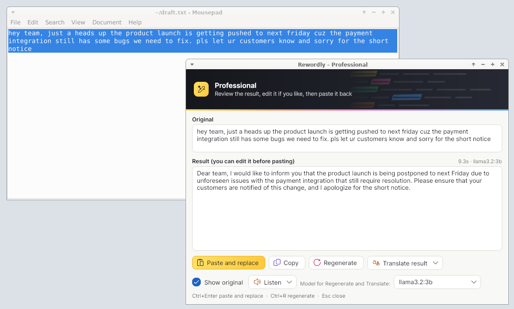
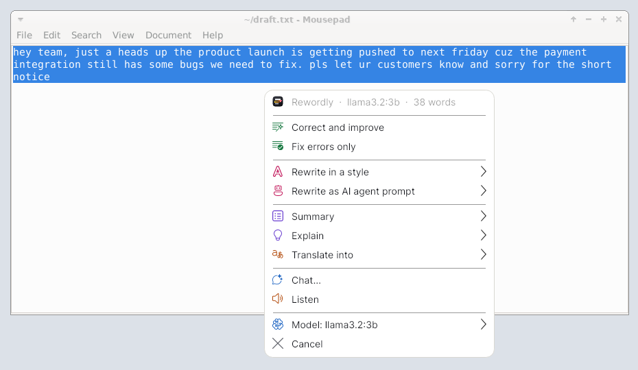
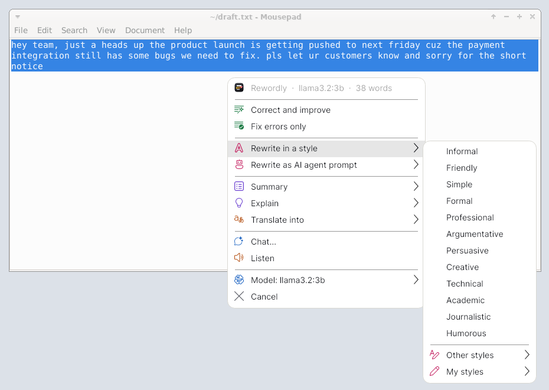
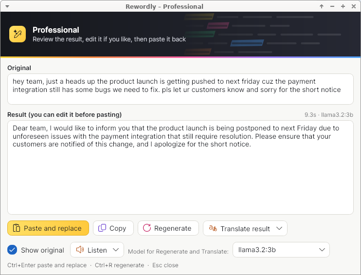
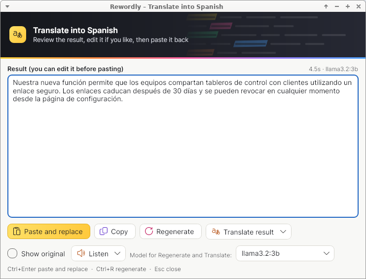
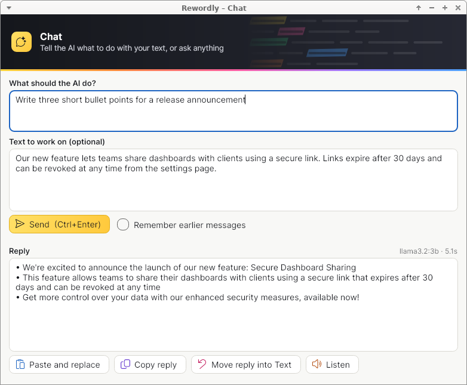
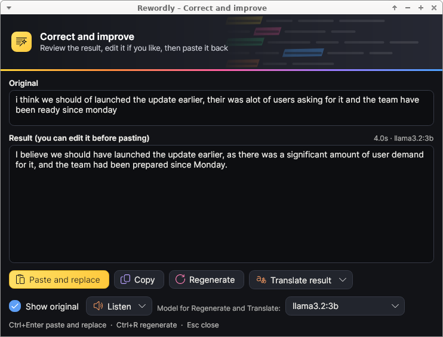
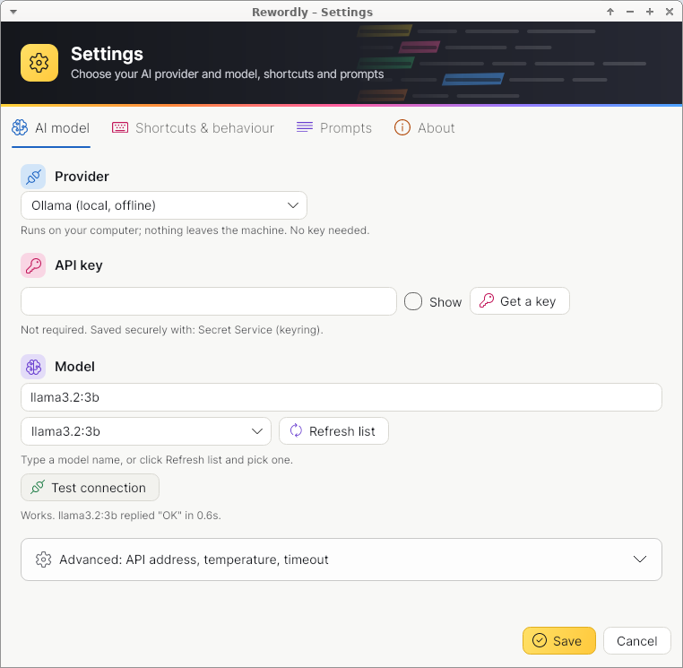
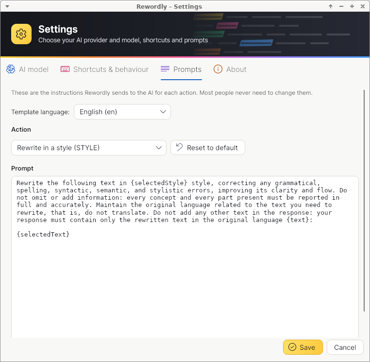

# Rewordly documentation

Rewordly rewrites, proofreads, summarises, explains, translates, chats about or reads aloud any text you select, in any app on Windows, macOS and Linux. Select text, press `Ctrl+C` twice (`Cmd+C` on macOS), and pick an action from the menu that opens at your pointer.

## Screenshots

| | |
| --- | --- |
|  |  |
| Select text, press `Ctrl+C` twice: the menu opens at your pointer. | 12 main styles, 5 extra styles and your own. |
|  |  |
| Compare, edit, regenerate, then paste back in place. | Translate into 27 languages or any language you type. |
|  |  |
| Chat about the selected text with your own instruction. | System, light and dark themes. |
|  |  |
| Gemini, OpenAI, OpenRouter, Groq, Ollama or any OpenAI-compatible server. | Every prompt is editable, in 6 languages. |

## Guides

| Guide | What it covers |
| --- | --- |
| [Getting started](getting-started.md) | Install Rewordly, connect an AI model and rewrite your first text. |
| [Using Rewordly](using-rewordly.md) | Every action in the menu, the result window, Chat, Listen and the tray menu. |
| [AI providers](ai-providers.md) | Gemini, OpenAI, OpenRouter, Groq, Ollama and OpenAI-compatible servers; API keys and models. |
| [Settings](settings.md) | Every Settings tab: shortcuts, clipboard, theme, startup, prompt editor and About. |
| [Troubleshooting](troubleshooting.md) | Fixes for shortcuts, permissions, slow or chatty models, and other common problems. |

## More

- [Prompt templates](../prompts/README.md): how the **Rewrite as AI agent prompt** templates work and how to add one.
- [Build from source](../README.md#build-from-source) and [Releasing](../README.md#releasing): for developers.
- [Changelog](../CHANGELOG.md): what changed in each release.
- [Contributing](../CONTRIBUTING.md) and [Security policy](../SECURITY.md).

Rewordly is developed by [Shobhit Kumar Prabhakar](https://shobhit.net). The screenshots in these guides were taken on Linux (Ubuntu 24.04, XFCE) with a local Ollama model; Rewordly looks the same on Windows and macOS apart from the window frames.
