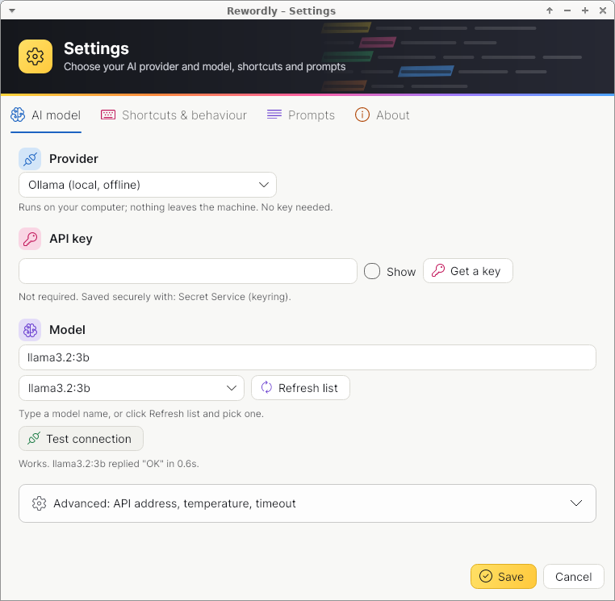

# AI providers

Rewordly does not run its own cloud service. It sends your selected text straight from your computer to the AI provider you choose, using your own account or a model on your own machine.

Set the provider under **Settings › AI model**.



## Supported providers

| Provider | Key needed | Get a key | Environment variables |
| --- | --- | --- | --- |
| Google Gemini (free tier available) | Yes | [Google AI Studio](https://aistudio.google.com/apikey) | `GEMINI_API_KEY`, `GOOGLE_API_KEY` |
| OpenAI | Yes | [OpenAI API keys](https://platform.openai.com/api-keys) | `OPENAI_API_KEY` |
| OpenRouter (many providers) | Yes | [OpenRouter keys](https://openrouter.ai/keys) | `OPENROUTER_API_KEY` |
| Groq | Yes | [Groq console](https://console.groq.com/keys) | `GROQ_API_KEY` |
| Ollama (local, offline) | No | — | — |
| Custom OpenAI-compatible | Depends on the server | — | — |

The **Get a key** button opens the right page for the selected provider. If an environment variable is set, Rewordly uses it when the API key field is empty.

## API keys are stored encrypted

Keys you paste into Settings are saved in your operating system's secure storage, never in the settings file:

- **Windows:** DPAPI, tied to your Windows account.
- **macOS:** the Keychain.
- **Linux:** the Secret Service (GNOME Keyring, KWallet), or an encrypted local file (AES-256-GCM) when no keyring is available.

**Settings › About** shows which one is in use on your computer.

## Choosing a model

- Type a model name in **Model**, or click **Refresh list** to load the models your key can use and pick one.
- **Test connection** sends a tiny request and reports whether it worked and how long it took.
- Models you use appear under **Model:** at the bottom of the action menu and in the tray menu, so you can switch quickly.
- In the result window, **Model for Regenerate and Translate** lets you retry one result with another model.

## Advanced settings

Open **Advanced: API address, temperature, timeout** on the AI model tab to change:

- **API address:** the base URL, for a proxy, a self-hosted gateway or a custom server.
- **Temperature:** lower is more predictable, higher is more creative. Leave it empty to use the model's default.
- **Timeout:** how long to wait for an answer (60 seconds by default).

## Offline use with Ollama

[Ollama](https://ollama.com) runs open models on your own computer, so no text leaves your machine.

1. Install Ollama from [ollama.com](https://ollama.com).
2. Download a model, for example:
   ```bash
   ollama pull llama3.2
   ```
3. In **Settings › AI model**, choose **Ollama (local, offline)**, click **Refresh list**, pick the model and click **Save**.

Small models such as `llama3.2:3b` are fast and good for corrections, translations and short rewrites. For long texts or **Rewrite as AI agent prompt**, a larger model (or a cloud model) follows the instructions more closely.

## Custom OpenAI-compatible servers

Choose **Custom OpenAI-compatible** for any server that speaks the OpenAI Chat Completions API, such as LM Studio, vLLM, LocalAI or a company gateway. Enter its **API address** (for example `http://localhost:1234/v1`), an API key if the server needs one, and the model name.
