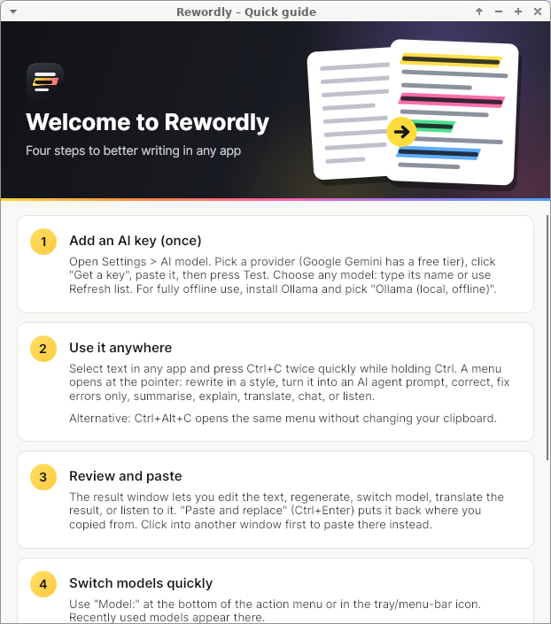
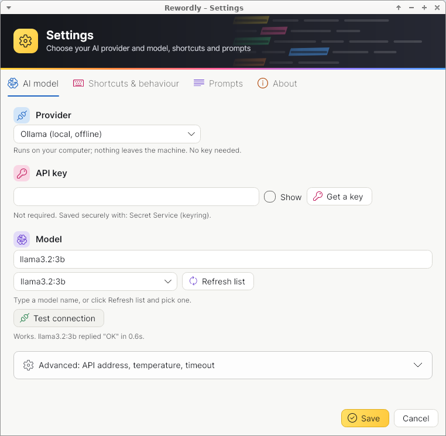
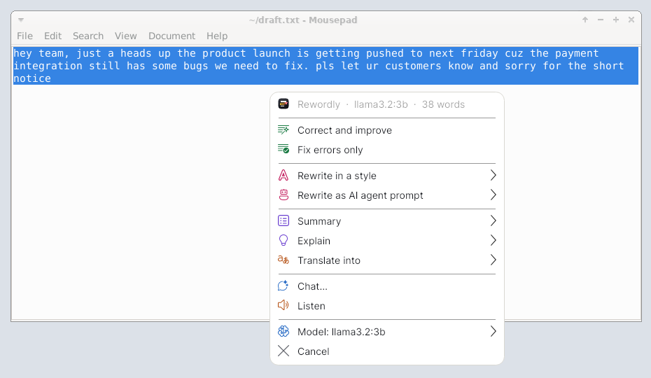
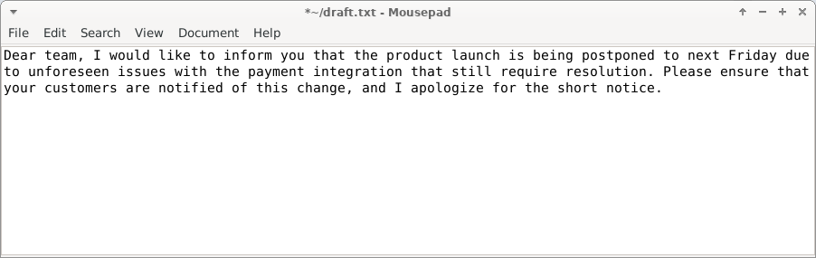

# Getting started

This guide takes you from download to your first rewrite in about five minutes.

## 1. Download and install

Download the archive for your system from the [latest release](https://github.com/GeekLord/Rewordly/releases/latest):

| System | Download |
| --- | --- |
| Windows 10/11 (Intel or AMD) | `Rewordly-<version>-win-x64.zip` |
| Windows 11 on ARM | `Rewordly-<version>-win-arm64.zip` |
| macOS 11+ on Apple Silicon | `Rewordly-<version>-osx-arm64.zip` |
| macOS 11+ on Intel | `Rewordly-<version>-osx-x64.zip` |
| Linux (X11) x64 / ARM64 | `Rewordly-<version>-linux-x64.tar.gz` / `-linux-arm64.tar.gz` |

Each download is a single self-contained app; you do not need to install .NET or anything else. The step-by-step install for each system, including the macOS permission prompts and the Linux helper packages, is in the main README:

- [Windows installation](../README.md#windows-installation)
- [macOS installation](../README.md#macos-installation)
- [Linux installation](../README.md#linux-installation)

To check a download, compare its SHA-256 hash with the line in `SHA256SUMS.txt` from the same release.

## 2. Start Rewordly

Start Rewordly. It runs in the background with an icon in the system tray (Windows), menu bar (macOS) or panel (Linux). The first time, the **Quick guide** and **Settings** open.

## 3. Connect an AI model

Rewordly sends your text to an AI model that you choose. In **Settings › AI model**:

1. Pick a **Provider**. Google Gemini has a free tier; Ollama runs fully offline on your own computer.
2. For a cloud provider, click **Get a key**, create an API key on the provider's site and paste it into **API key**.
3. Type a model name, or click **Refresh list** and pick one.
4. Click **Test connection**. You should see "Works" with the model's reply time.
5. Click **Save**.

See [AI providers](ai-providers.md) for each provider, environment variables and offline use with Ollama.

## 4. Rewrite your first text

1. In any app (email, chat, a document, a browser), select some text.
2. Press `Ctrl+C` twice quickly while holding `Ctrl` (`Cmd+C` twice on macOS). The Rewordly menu opens at your pointer.
3. Pick an action, for example **Rewrite in a style › Professional**.

   

4. Review the result. You can edit it, tick **Show original** to compare, or click **Regenerate**.
5. Click **Paste and replace** (`Ctrl+Enter` / `Cmd+Enter`). Rewordly puts the result back where your selection was.

   

If you don't want Rewordly to touch your clipboard, use the alternative shortcut instead of the double copy: `Ctrl+Insert` on Windows, `Ctrl+Cmd+C` on macOS, `Ctrl+Alt+C` on Linux.

## Next steps

- [Using Rewordly](using-rewordly.md): everything the menu can do.
- [Settings](settings.md): change the shortcuts, theme, word limit and prompts.
