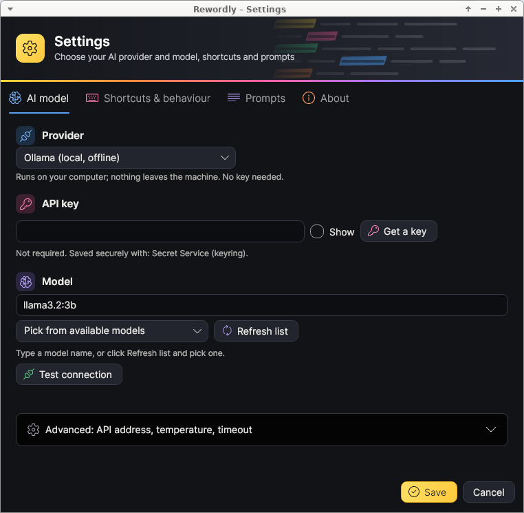
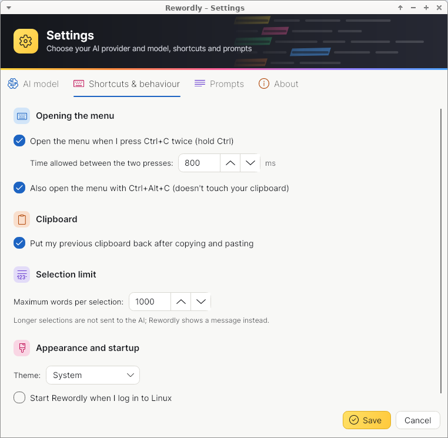
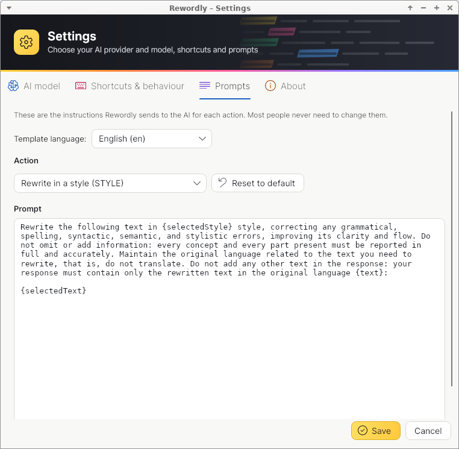
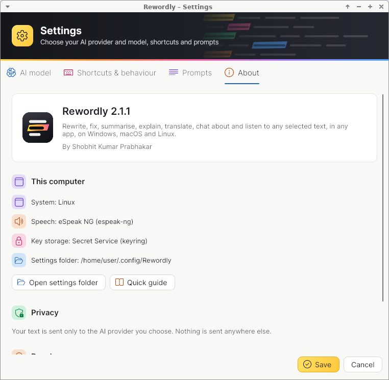
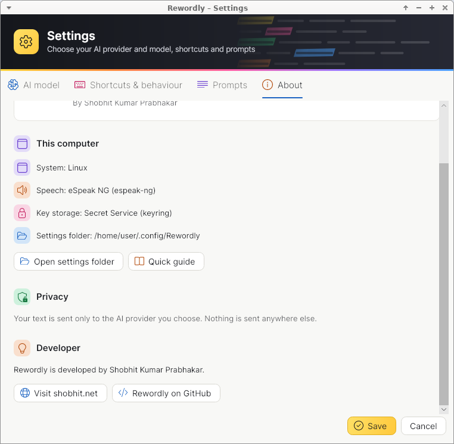

# Settings

Open Settings by clicking the Rewordly icon in the tray, menu bar or panel, or from its menu. Changes apply when you click **Save**. The window follows the system, light or dark theme.

## AI model

Provider, API key, model and connection test. See [AI providers](ai-providers.md).

## Shortcuts & behaviour

**Opening the menu**

- **Open the menu when I press Ctrl+C twice:** the main trigger. **Time allowed between the two presses** is 800 ms by default; raise it if the menu doesn't open reliably, lower it if it opens when you didn't mean it to.
- **Also open the menu with Ctrl+Alt+C** (`Ctrl+Insert` on Windows, `Ctrl+Cmd+C` on macOS): copies the selection without changing your clipboard.

**Clipboard**

- **Put my previous clipboard back after copying and pasting:** Rewordly uses the clipboard to read your selection and to paste the result. With this on, whatever you had copied before is restored afterwards.

**Selection limit**

- **Maximum words per selection** (1000 by default). Longer selections are not sent to the AI; Rewordly shows a message instead. This protects you from sending a whole document by accident.

**Appearance and startup**

- **Theme:** System, Light or Dark.
- **Start Rewordly when I log in:** uses the Windows Run key, a macOS LaunchAgent or a Linux autostart entry.

## Prompts

Every instruction Rewordly sends to the AI is editable.

- **Template language:** the language of the built-in prompts: English, Italian, Spanish, French, German or Hindi. With Hindi, the menus are in Hindi too.
- **Action:** the prompt to edit, including the system instruction, the chat instruction and each **AI agent prompt** variant.
- **Prompt:** the text sent to the AI. Placeholders such as `{selectedText}`, `{selectedStyle}` and `{num}` are replaced with your selection, the chosen style or the word limit.
- **Reset to default** restores the built-in prompt for that action.

Your edited prompts are kept when you update Rewordly; new built-in prompts only apply to prompts you have not edited. To share an improved **AI agent prompt** template with everyone, see [`prompts/README.md`](../prompts/README.md).

## About

- The **version** you are running and the developer.
- **This computer:** your system, the speech engine, where API keys are stored and the settings folder. **Open settings folder** and **Quick guide** buttons.
- **Privacy:** your text is sent only to the AI provider you choose.
- **Developer:** links to [shobhit.net](https://shobhit.net) and the GitHub repository.

## Where settings are stored

| Item | Windows | macOS | Linux |
| --- | --- | --- | --- |
| Settings file | `%APPDATA%\Rewordly\settings.json` | `~/Library/Application Support/Rewordly/settings.json` | `~/.config/rewordly/settings.json` |
| API keys | Windows DPAPI | macOS Keychain | Secret Service or encrypted local file |
| Start at login | `HKCU\Software\Microsoft\Windows\CurrentVersion\Run` | `~/Library/LaunchAgents/com.rewordly.app.plist` | `~/.config/autostart/rewordly.desktop` |

Set the `REWORDLY_CONFIG_DIR` environment variable to keep the settings in another folder, for example on a portable drive.
