# Using Rewordly

Select text in any app and press `Ctrl+C` twice (`Cmd+C` twice on macOS) to open the menu at your pointer. The top line shows the model in use and how many words you selected.

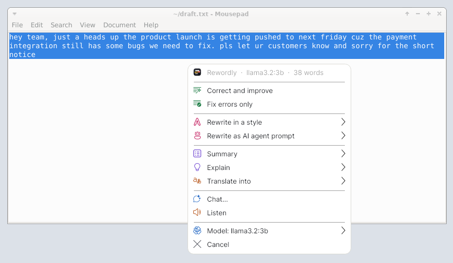

The styles you used most recently appear near the top of the menu, so your favourites are one click away. The menu follows the system, light or dark [theme](settings.md#shortcuts--behaviour).

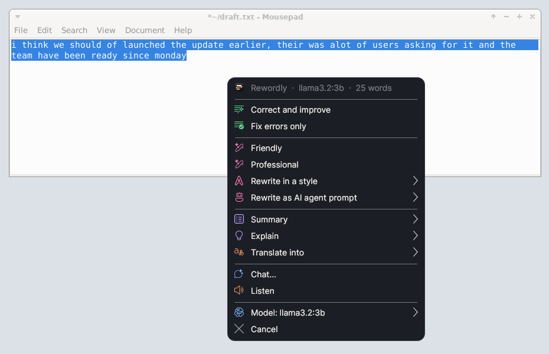

## Actions

### Correct and improve, Fix errors only

- **Correct and improve** fixes grammar, spelling and wording and improves clarity and flow, without adding or removing information.
- **Fix errors only** keeps your text exactly as written apart from grammar, spelling and syntax mistakes.

Both keep the original language; they never translate.

### Rewrite in a style

Rewrites the text in one of 12 main styles: Informal, Friendly, Simple, Formal, Professional, Argumentative, Persuasive, Creative, Technical, Academic, Journalistic and Humorous.

- **Other styles:** Narrative, Descriptive, Expository, Poetic and Satirical.
- **My styles › Add a style…:** describe your own style, for example "LinkedIn post" or "polite reply to a customer". Right-click one of your styles to delete it.

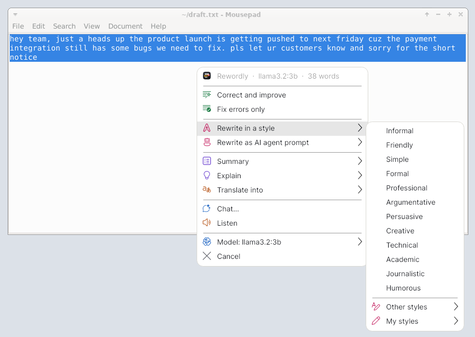

### Rewrite as AI agent prompt

Turns a rough request into a clear, complete prompt for another AI. Pick the target:

- **General agent**, **Coding agent**, **Research agent**, **System prompt** or **Chat assistant**.
- **Image AI › Image generation** or **Image editing:** a prompt for text-to-image models or AI image editors.

Rewordly keeps every fact from your draft, adds the structure the target needs (goal, context, constraints, output, a fitting role) and marks missing essentials with `[placeholders]` instead of guessing. The templates are plain text files in [`prompts/agent-prompt/`](../prompts/README.md).

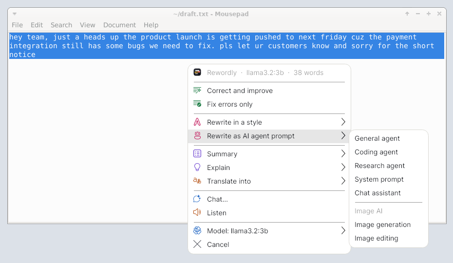

### Summary

Shortens the text to about 70%, 50% or 30% of its length. Each entry shows the approximate word count it aims for.

### Explain

Explains the text for a reader's knowledge level: **None**, **Basic**, **Intermediate** or **Advanced**.

### Translate into

Translates into 27 built-in languages. **Other languages** has more, and **Another language…** lets you type any language, such as "Brazilian Portuguese" or "Hinglish". Languages you add and use often stay in the menu.

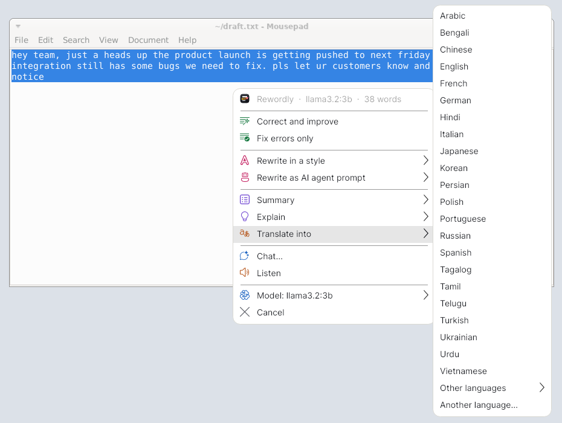

### Chat…

Opens the Chat window with your selection as the text to work on. Write any instruction, for example "Reply to this email politely and say I'll call tomorrow", and press **Send** (`Ctrl+Enter`).

- **Remember earlier messages** keeps the conversation going across several requests.
- **Paste and replace**, **Copy reply**, **Move reply into Text** (to work on the reply again) and **Listen**.

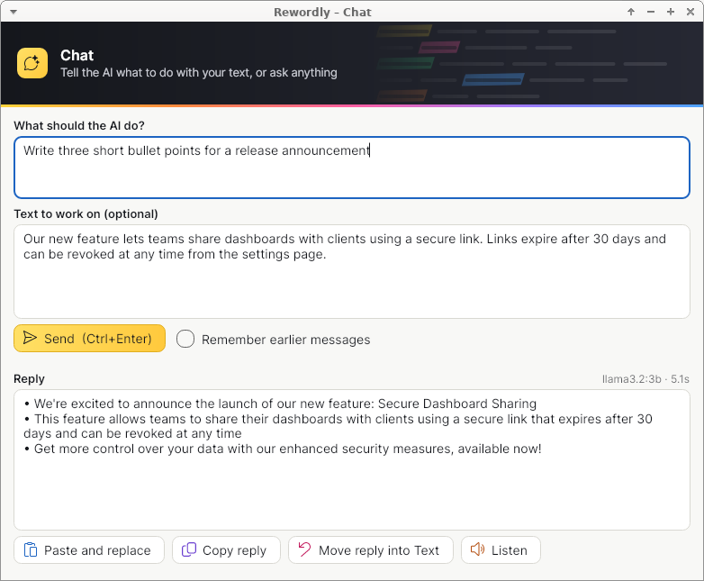

### Listen

Reads the selection aloud with your computer's own voices, offline. Choose a **Voice** and **Speed**; **Get more voices** opens the system voice settings on Windows and macOS, and explains which packages to install on Linux. The engine is Windows SAPI on Windows, `say` on macOS, and `espeak-ng`, `espeak` or `spd-say` on Linux.

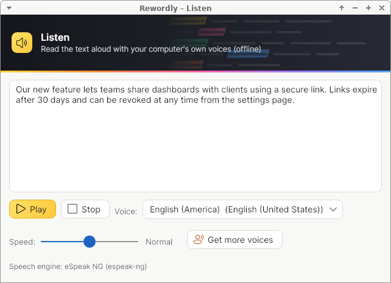

## The result window

Every action except Chat and Listen opens the result window.

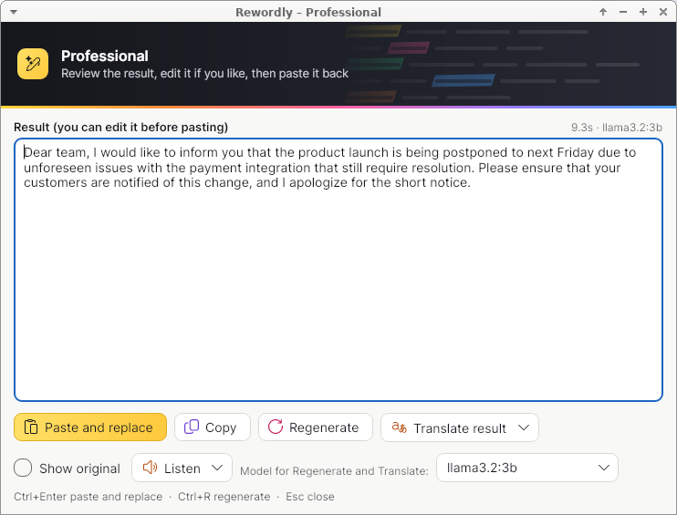

- **Edit** the result directly before you paste it.
- **Show original** displays your selection above the result for comparison.
- **Paste and replace** (`Ctrl+Enter` / `Cmd+Enter`) pastes the result over your selection in the app you came from. To paste somewhere else, click into that window first.
- **Copy** copies the result.
- **Regenerate** (`Ctrl+R` / `Cmd+R`) asks the model again, optionally with a different model from **Model for Regenerate and Translate**.
- **Translate result** translates the result into another language; **Undo translation** brings the previous version back.
- **Listen** reads the result aloud.
- `Esc` closes the window.

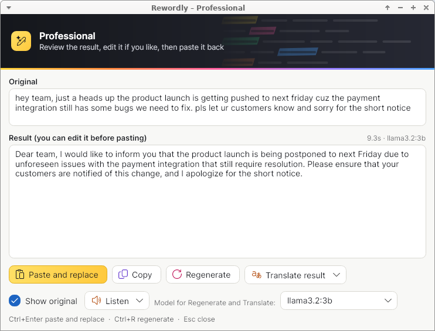

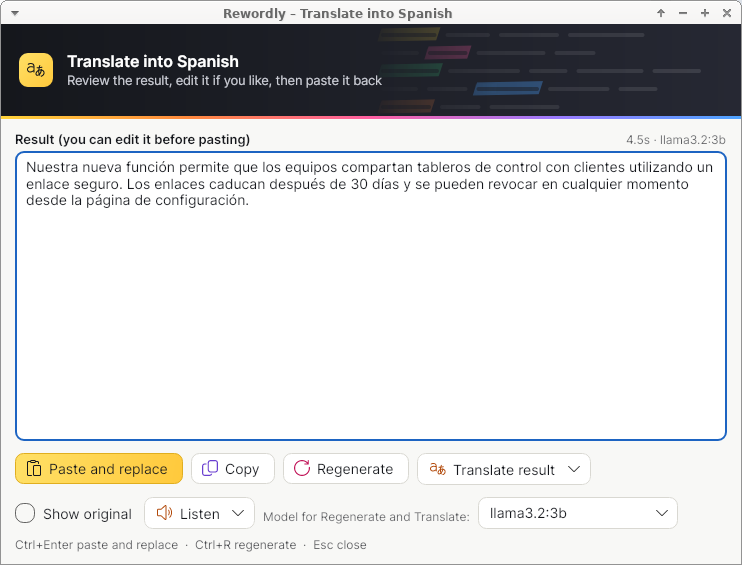

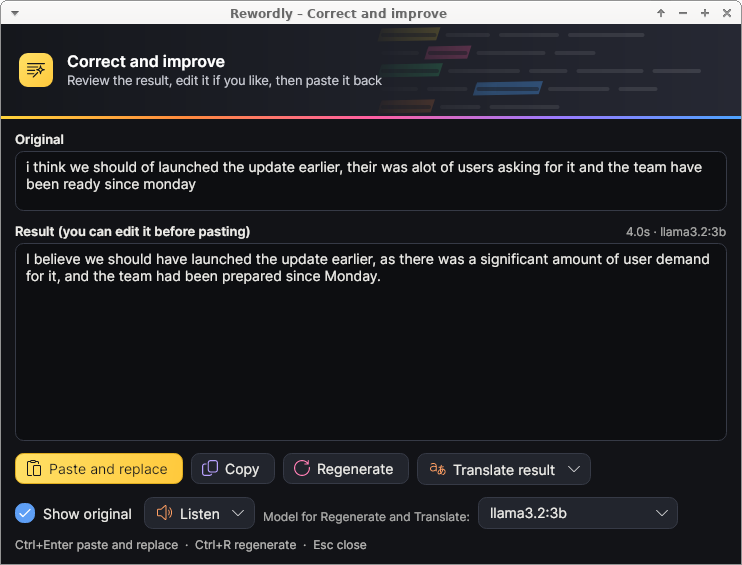

## The tray menu

Click the Rewordly icon in the tray, menu bar or panel to open Settings. Its menu (right-click on Windows and Linux) offers:

- **Model:** switch between recently used models, or **Choose another model…**
- **Settings…**, **Chat…** and **Quick guide**
- **Pause shortcuts:** stop Rewordly reacting to the copy shortcut, for example during a game or a screen share
- **Open data folder** and **Quit Rewordly**

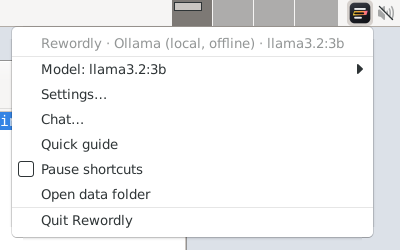

## Keyboard shortcuts

| Action | Windows | macOS | Linux (X11) |
| --- | --- | --- | --- |
| Open the menu | `Ctrl+C` twice (hold `Ctrl`) | `Cmd+C` twice (hold `Cmd`) | `Ctrl+C` twice (hold `Ctrl`) |
| Open the menu without touching the clipboard | `Ctrl+Insert` | `Ctrl+Cmd+C` | `Ctrl+Alt+C` |
| Paste and replace | `Ctrl+Enter` | `Cmd+Enter` | `Ctrl+Enter` |
| Regenerate | `Ctrl+R` | `Cmd+R` | `Ctrl+R` |
| Send in Chat | `Ctrl+Enter` | `Cmd+Enter` | `Ctrl+Enter` |
| Close a window | `Esc` | `Esc` | `Esc` |
